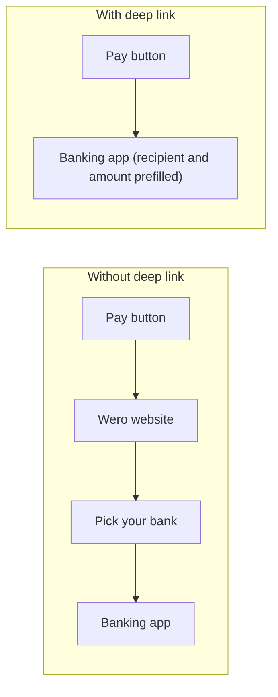

# Wero Payment Deep Links – Direct Banking App Launch

I wanted to have a pay with Wero button in my app so i did some research on how to open a Wero payment straight in the payer's banking app, with recipient and amount prefilled, without bank connections or payment APIs.



### 1. The payment link

```text
https://share.weropay.eu/p/1/s/TOKEN?a=500&c=EUR
```

- `TOKEN` – the recipient's Wero share token
- `a=500` – amount in cents
- `c=EUR` – currency

Opening this link shows Wero's bank picker webite first. To skip it, use a bank deep link.

### 2. Opening the bank app directly

```text
BANK_LINK?wero-uc=share&wero-url=ENCODED_WERO_URL
```

- `BANK_LINK` – the payer's bank, from the table below
- `ENCODED_WERO_URL` – the URL-encoded payment link from step 1

Example (N26, €5.00):

```text
https://app.n26.com/wl/wero/open-request?wero-uc=share&wero-url=https%3A%2F%2Fshare.weropay.eu%2Fp%2F1%2Fs%2FTOKEN%3Fa%3D500%26c%3DEUR
```

**Verified on iOS:** N26 opens directly with the correct recipient and amount prefilled.

Apps shared by many banks (VR Banking App, Sparda, PSD) also need `&wero-bank-context=BIC`, the BIC of the payer's bank.

### 3. Bank links

| Bank | Country | Bank link | Tested |
|---|---|---|---|
| N26 | DE, FR | `https://app.n26.com/wl/wero/open-request` | ✅ iOS |
| Sparkasse | DE | `https://www.sparkasse.de/_deeplink/wero` | – |
| ING Deutschland | DE | `https://banking.ing.de/app/da_wero` | – |
| Volksbanken Raiffeisenbanken (VR Banking App) | DE | `https://vr.banking-app-links.de/dynamicKey/wero` + BIC | – |
| Volksbanken Raiffeisenbanken (MyBanking) | DE | `https://mybanking.banking-app-links.de/dynamicKey/wero` | – |
| Frankfurter Volksbank | DE | `https://fvb.banking-app-links.de/dynamicKey/wero` | – |
| Sparda Banken | DE | `https://sparda.banking-app-links.de/dynamicKey/wero` + BIC | – |
| PSD Banken | DE | `https://psd.banking-app-links.de/dynamicKey/wero` + BIC | – |
| BBBank | DE | `https://bb.banking-app-links.de/dynamicKey/wero` | – |
| BW Bank | DE | `https://app.bw-bank.de/_deeplink/wero-consent` | – |
| GLS Bank | DE | `https://gls.banking-app-links.de/dynamicKey/wero` | – |
| MLP | DE | `https://mlp.banking-app-links.de/dynamicKey/wero` | – |
| Revolut | DE, FR, BE | `https://revolut.com/app/wero` | – |
| bunq | NL, DE, FR, BE | `https://go.bunq.com/link/wero` | – |
| Nickel | DE, FR, BE | `https://app.nickel.eu/wero` | – |

<details>
<summary>Belgium and France</summary>

| Bank | Country | Bank link |
|---|---|---|
| BNP Paribas Fortis | BE | `https://app.easybanking.bnpparibasfortis.be/mobile/wero` |
| Belfius | BE | `https://www.belfius.be/common/nl/fw/generic/wero.html?appkey=WERO_URL_INTENT` |
| Beobank Pay | BE | `https://appp-beopay-applinks.e-i.com/home/` |
| CBC | BE | `https://ul.cbc.be/clc-payPaymentRequest` |
| Crelan | BE | `https://deeplink.crelan.be/app/wero-share-p2p-payment-link` |
| Fintro | BE | `https://app.easybanking.fintro.be/mobile/wero` |
| Hello bank! Belgium | BE | `https://app.easybanking.hellobank.be/mobile/wero` |
| ING Belgium | BE | `https://www.ing.be/wero/p2p` |
| KBC | BE | `https://ul.kbc.be/clc-payPaymentRequest` |
| KBC Brussels | BE | `https://ul.kbcbrussels.be/clc-payPaymentRequest` |
| Nagelmackers | BE | `https://mobprd.nagelmackers.be/wero` |
| BNP Paribas (Mes Comptes) | FR | `https://mabanque.bnpparibas/fr/gerer/cartes-moyens-paiement/paiement-mobile/wero` |
| BRED | FR | `https://link.bred.fr/?link=https://link.bred.fr/redirect%3Flink%3Dwero&ibi=fr.bred.bred&apn=fr.bred.fr&isi=470182955` |
| CIC Pay | FR | `https://appp-cicpay-applinks.e-i.com/home/` |
| Crédit Mutuel Pay | FR | `https://appp-cmpay-applinks.e-i.com/home/` |
| Crédit Agricole | FR | `https://www.credit-agricole.fr/particulier/applications/ma-banque/paiement-wero.html` |
| SG | FR | `https://applink.particuliers.sg.fr/services-en-ligne/paiement-mobile-wero?src=wero` |
| LCL | FR | `https://www.lcl.fr/paiement-mobile/wero` |
| Monabanq Pay | FR | `https://appp-mbqpay-applinks.e-i.com/home/` |
| Fortuneo | FR | `https://www.fortuneo.fr/paiements` |
| Hello bank! France | FR | `https://www.hellobank.fr/fr/client/notre-offre/comptes-et-cartes/wero` |

</details>

These links come from Wero's own bank picker, which also publishes the full list as JSON: `https://start.wero-wallet.eu/api/brands`.

### 4. Open questions

- Share-link expiration and reusability need further testing.
- Only N26 is tested so far.
- These links are undocumented and may change. Falling back to the plain `share.weropay.eu` link always works.

Contributions are welcome! If you test a bank, please post the bank, iOS or Android, and whether the recipient and amount were prefilled.
